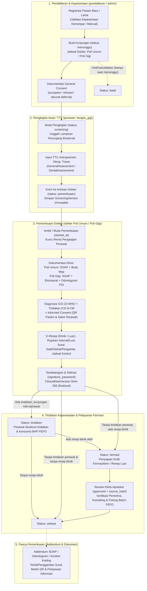

# 00 — EXECUTIVE SUMMARY & ROADMAP PENYEMPURNAAN PRA-RILIS

**Proyek:** Aplikasi Rekam Medis Elektronik (RME) — Klinik Pratama Kementerian Pariwisata  
**Cakupan Layanan:** Poli Umum, Poli Gigi, Pendaftaran & Kepesertaan Internal, Pengkajian Perawat/Terapis Gigi, Tindakan Klinis, Farmasi & Gudang Obat, Persuratan Medis, serta Manajemen/Pelaporan  
**Tech Stack Aktual:** Laravel 13 (`^13.17`, PHP `^8.3`), Inertia.js 3.0/3.8, React 19.3, TypeScript 5.9, Tailwind CSS v4.0, Radix UI, SQLite (lokal/default)  
**Tanggal Audit:** 25 November 2026  
**Mode Audit:** _Read-Only Deep Codebase & Schema Inspection_ (Tanpa mengubah satu baris pun kode aplikasi)

---

## 1. Ringkasan Eksekutif & Apresiasi Fondasi Eksisting (Pasca-UAT)

Berdasarkan pemindaian menyeluruh terhadap **48 tabel database**, **130 file migrasi**, **250+ endpoint rute**, **43 controller + 40+ domain service**, serta **190+ file komponen/halaman React TypeScript**, tim audit multi-disiplin menyimpulkan bahwa aplikasi RME Klinik Pratama Kementerian Pariwisata **memiliki fondasi rekayasa dan tata kelola klinis yang jauh di atas rata-rata SIMKlinik standar**.

### Kekuatan Utama yang Wajib Dipertahankan (_Zero Total Rewrite_)

1. **Integritas & Immutability Catatan Klinis:** Catatan pemeriksaan dokter telah menggunakan _append-only versioning_ berantai hash kriptografis SHA-256 (`app/ClinicalNoteRecorder.php`, tabel `clinical_note_versions`), pengkajian perawat berversi (`screening_versions`), mekanisme _void-without-delete_ pada entri draf klinis (`RetainsCancelledClinicalEntries`), serta 39 _database triggers_ (`protect_*_delete` dan `protect_*_update`) yang aktif mencegah penghapusan destruktif.
2. **Isolasi Kerahasiaan Medis & RBAC Ketat:** Middleware `ProtectClinicalInformation` (`app/Http/Middleware/ProtectClinicalInformation.php`) dan `KunjunganPolicy` telah memblokir peran `admin` maupun `pendaftaran` dari membaca isi klinis/SOAP pasien, didukung _k-anonymity_ (`HAVING COUNT(DISTINCT pasien_id) >= 5` pada `RegistrationController.php:715`) pada pelaporan agregat serta proteksi injeksi formula spreadsheet (`SafeSpreadsheetValueBinder`).
3. **Tata Kelola Persetujuan & Farmasi Klinis Modern:** Aplikasi telah memiliki alur _General Consent_ berversi dengan verifikasi integritas berkas SHA-256 (`GeneralConsentService`), _Informed Consent_ tindakan dengan sesi tanda tangan QR pasien + saksi perawat (`ProcedureSignatureController`), serta _Clinical Review_ Apoteker berbasis `source_hash` (`PharmacyClinicalReviewService`) dan manajemen stok batch FEFO ter-lock (`PersediaanRecorder`).
4. **Disiplin Pengujian Otomatis yang Kuat:** Memiliki basis pengujian regresi masif (624 pengujian fitur backend PHPUnit dan 312 pengujian SSR render frontend `tests/frontend-render.test.mjs`) yang menjadi jaring pengaman utama dalam proses _surgical refactoring_ menuju Staging/Produksi.

---

## 2. Skor Kesiapan Pra-Rilis per Dimensi Audit

Penilaian dilakukan secara seimbang oleh keempat fungsi tim audit berdasarkan bukti faktual di kode sumber saat ini:

| Dimensi Audit                                                      | Perspektif Penilai Utama                     | Skor Saat Ini  |           Status Kesiapan            | Ringkasan Catatan Kritis                                                                                                                                                                                                                                                                                  |
| :----------------------------------------------------------------- | :------------------------------------------- | :------------: | :----------------------------------: | :-------------------------------------------------------------------------------------------------------------------------------------------------------------------------------------------------------------------------------------------------------------------------------------------------------- |
| **1. Alur Klinis & Keselamatan Pasien (Poli Umum, Gigi, Farmasi)** | _Clinical Informatics & QA Lead_             |  **78 / 100**  | **Siap dengan Penyempurnaan Wajib**  | Alur utama UAT solid; namun belum ada _auto-check_ alergi obat saat peresepan, angka TTV kritis belum memicu triase otomatis, status hamil/menyusui belum terstruktur ke resep/farmasi, etiket obat & kop surat Kemenpar belum lengkap.                                                                   |
| **2. Kepatuhan Regulasi (PMK 24/2022, Akreditasi PKP, UU PDP)**    | _Healthcare Compliance & Security Architect_ |  **76 / 100**  | **Perlu Penutupan Celah Kepatuhan**  | Retensi, _consent_, & _release register_ kuat; namun PII/NIK masih _plaintext_ di DB (`SESSION_ENCRYPT=false`), belum ada _gate_ koreksi lewat 2x24 jam pada addendum, Resume Medis (`ringkasan`) belum memuat seluruh elemen Pasal 22, & TTE masih lokal.                                                |
| **3. Kesiapan Arsitektur Data SATUSEHAT (_By Design_)**            | _Clinical Informatics & DB Architect_        |  **62 / 100**  | **Butuh Penambahan Kolom Additive**  | ICD-10 WHO & ICD-9-CM sudah rapi; namun `nakes.nik` & `ihs_number` belum ada, `pasien` belum punya kode wilayah Kemendagri & `ihs_number`, `klinik_settings`/`ruang_poli` belum punya ID SATUSEHAT, alergi masih teks bebas, dan `aturan_pakai` resep belum terstruktur.                                  |
| **4. Backend, Database, Performa & Keamanan**                      | _Principal Backend & Security Architect_     |  **72 / 100**  | **4 Blocker Kritis Sebelum Staging** | Tabel `kunjungan` belum memiliki indeks pada `tanggal`/`status`/`pasien_id`/`poliklinik_id`/`dokter_id`, verifikasi hash seluruh histori pada laporan Top Diagnosa berisiko _timeout_, SQLite masih mode `DELETE` (bukan `WAL`)/portabilitas MariaDB patah, & celah _reset password_ tanda tangan dokter. |
| **5. Frontend, Konsistensi UI/UX & Ergonomi Nakes**                | _Senior Frontend & Design System Lead_       |  **75 / 100**  |  **Butuh Standarisasi & Ergonomi**   | Bebas utilitas usang Tailwind v3; namun kontras _dark mode_ pada `<Alert>` gagal WCAG AA, belum ada _sticky patient/allergy banner_ & _unsaved-changes guard_, semua sel tabel rata tengah (`text-center`), pajak klik modal berlebihan, & _overflow_ tabel di laptop 1280–1366px.                        |
| **SKOR RATA-RATA KESIAPAN PRA-RILIS**                              | **Konsensus 4 Peran**                        | **72,6 / 100** |    **CONDITIONAL GO FOR STAGING**    | **Sangat layak masuk Staging setelah Fase 1 & Fase 2 (Surgical Fixes) diselesaikan tanpa merombak alur UAT.**                                                                                                                                                                                             |

---

## 3. Peta Alur Aplikasi Eksisting (_As-Is End-to-End Flow_)

---

## 4. Roadmap Perbaikan & _Surgical Refactoring_ Bertahap

Seluruh rekomendasi disusun dengan prinsip **Additive Schema & Surgical Refactoring** (tanpa mengubah kontrak URL, nama _prop_ utama Inertia, maupun _selector_ DOM yang diuji oleh 624 tes PHPUnit dan 312 tes SSR frontend).

| Fase                                                             | Fokus Utama                                                                                            | Daftar Paket Pekerjaan Konkret                                                                                                                                                                                                                                                                                                                                                                                                                                                                                                                                                                                                                                                                                                                                                                                                                                                                                                                                                                                                                                                                                                                                                                                                                                                                                                         |                     Kategori Rilis                      |                                  Risiko Regresi UAT                                  |
| :--------------------------------------------------------------- | :----------------------------------------------------------------------------------------------------- | :------------------------------------------------------------------------------------------------------------------------------------------------------------------------------------------------------------------------------------------------------------------------------------------------------------------------------------------------------------------------------------------------------------------------------------------------------------------------------------------------------------------------------------------------------------------------------------------------------------------------------------------------------------------------------------------------------------------------------------------------------------------------------------------------------------------------------------------------------------------------------------------------------------------------------------------------------------------------------------------------------------------------------------------------------------------------------------------------------------------------------------------------------------------------------------------------------------------------------------------------------------------------------------------------------------------------------------- | :-----------------------------------------------------: | :----------------------------------------------------------------------------------: |
| **FASE 1** _Critical Security, DB Engine & Clinical Safety_  | Menutup _blocker_ keamanan, kepatuhan kritis PMK 24/UU PDP, performa DB, & keselamatan pasien langsung | **1.1** Migrasi indeks komposit kritis pada `kunjungan`, `pasien(nik)`, `clinical_audit_events`, `stok_mutasi`, `farmasi`, `surat_medis`, `pharmacy_clinical_reviews` + penggantian `whereDate()` non-sargable. **1.2** Aktifkan SQLite `WAL` (`DB_JOURNAL_MODE=wal`), perbaiki kompatibilitas trigger MariaDB/MySQL/PG + `CheckClinicalSecurity`, bersihkan 6 file `.sqlite.bak` di `database/`, dan set `SESSION_ENCRYPT=true`. **1.3** Perbaiki `EffectiveDiagnosisReport` agar tidak memverifikasi ulang seluruh histori JSON secara sinkron saat membuka laporan Top Diagnosa. **1.4** Tutup celah _non-repudiation_ tanda tangan dokter saat Admin _reset password_ (`UserController@resetPassword`), wajibkan `current_password` + versi imutabel pada unggah tanda tangan (`ProfileController`), dan _masking_ kebocoran `no_rm` di `ObatController@stok`. **1.5** Integrasikan angka TTV kritis ke eskalasi triase otomatis (`determineTriage`), tambahkan kolom terstruktur Kehamilan & Menyusui ke pengkajian -> resep -> review farmasi, dan pasang peringatan silang alergi obat + cek stok layak pakai di `PemeriksaanController@storeResep`. **1.6** Tetapkan nomor antrean persisten (`no_antrian`) pada `kunjungan` dan perbaiki `KunjunganController@store` (`registered_by` & transaksi nomor). |       **WAJIB PRA-RILIS** _(Go-Live Blocker)_       |           **Rendah** _(Murni backend/DB additive & validasi pengaman)_           |
| **FASE 2** _SATUSEHAT-Ready Schema & Regulasi RME_           | Memastikan skema database _future-proof_ untuk integrasi SATUSEHAT tanpa bongkar ulang di masa depan   | **2.1** Migrasi _additive_ identitas SATUSEHAT: `nakes` (`nik` 16 digit, `ihs_number`, `tanggal_lahir`, `sip_berlaku_sampai`, `str_berlaku_sampai`), `klinik_settings` (`kode_fasyankes`, `satusehat_org_id`, kode wilayah), `poliklinik` & `ruang_poli` (`satusehat_org_id`, `satusehat_location_id`, `kode`). **2.2** Migrasi _additive_ demografi & kunjungan: `pasien` (`ihs_number`, kode wilayah Kemendagri `provinsi` s.d. `kelurahan`, `kode_pos`, `pendidikan`, `kewarganegaraan`), `general_consents` (`satusehat_sharing_decision`), `kunjungan` (`satusehat_encounter_id`, `ruang_poli_id`, `arrived_at`, `finished_at`). **2.3** Strukturisasi tabel `patient_allergies` (kode KFA/SNOMED + sinkronisasi dua arah dengan tampilan riwayat alergi eksisting) serta kolom terstruktur `dosageInstruction` (`frekuensi`, `dosis_sekali_minum`, `rute_pemberian`, `waktu_pakai`, `durasi_hari`) pada `resep_obat` dan metadata KFA pada `obat`. **2.4** Enkripsi _at-rest_ bertahap dengan _blind index_ (`nik_hash`, `nip_hash`) untuk PII sensitif sesuai UU PDP + _gate_ otorisasi Kepala Klinik untuk addendum lewat 2x24 jam (PMK 24/2022 Pasal 37).                                                                                                                                                         |  **WAJIB SEBELUM PRODUKSI** _(Schema Freeze Gate)_  | **Rendah – Sedang** _(Kolom baru bersifat nullable/default untuk data historis)_ |
| **FASE 3** _UI/UX Polish, Dark Mode & Ergonomi Nakes_        | Menyeragamkan desain, memperbaiki keterbacaan _dark mode_, dan memangkas friksi klik nakes             | **3.1** Perbaikan token `resources/css/app.css`: definisikan `--color-muted-foreground`, lengkapi palet `.dark` (`rose`, `cyan`, `teal`, `sky`), perbaiki kontras `<Alert>` di _dark mode_, hapus `@import` Livewire Flux yang tidak terpakai, dan beri warna semantik lembut pada `Badge` status antrean. **3.2** Perbaiki perataan teks tabel (`ui/table.tsx` default `text-left` untuk teks, `tabular-nums` untuk angka), ganti 5 form `<Field><input type="checkbox">` dengan komponen `<Checkbox>` sejajar, seragamkan `<h2>` pada 10 halaman, dan sesuaikan _grid split_ `xl:` menjadi `2xl:` untuk laptop klinik 1280–1366px. **3.3** Tambahkan `<PatientContextBar>` _sticky_ (Nama, No. RM, Usia, BB, TTV, Pill Alergi) dan `useUnsavedChangesGuard` pada halaman pengkajian, pemeriksaan, tindakan, dan farmasi. **3.4** Hapus modal konfirmasi ganda pada simpan draf rutin (`confirmSave`), ubah pencarian ICD-10/ICD-9-CM/Obat menjadi `<ClinicalCombobox>` yang mendukung navigasi keyboard penuh (`ArrowUp/Down/Enter`), dan pecah modular `pemeriksaan/show.tsx` (2.075 baris) ke sub-komponen tab.                                                                                                                                                                                                        | **WAJIB PRA-RILIS** _(Kenyamanan & Keselamatan UX)_ |        **Rendah – Sedang** _(Wajib menjaga ID & ARIA untuk 312 tes SSR)_         |
| **FASE 4** _Fitur Operasional Final Kemenpar & Post-Release_ | Menyempurnakan cetakan resmi klinik kementerian & menyiapkan kapabilitas lanjutan                      | **4.1 (Pra-Rilis Cepat):** Perbaiki nama klinik _hardcoded_ di `persuratan/cetak.tsx:115`, tambahkan `NIP` & `Unit Kerja` pada Surat Sakit, lengkapi elemen PMK 24 Pasal 22 pada Resume Medis (`ringkasan`), lengkapi `buta_warna`/`visus`/`IMT` pada Surat Sehat, perbaiki **Etiket Obat** sesuai Permenkes 73/2016 (Putih/Biru, 2 identitas pasien, SIPA, ED/BUD), dan akomodasi kategori `pppk` / `keluarga_asn` / `tamu_dinas` pada kepesertaan. **4.2 (Pasca-Rilis / Fase Lanjutan):** Dukungan resep racikan multi-komponen (`resep_racikan_items`), visualisasi Odontogram geometris 5-permukaan berstandar simbol Kemenkes/PDGI + indeks DMF-T/OHI-S, integrasi TTE Tersertifikasi BSrE-BSSN, serta modul _outbox/adapter_ pengiriman live API FHIR SATUSEHAT.                                                                                                                                                                                                                                                                                                                                                                                                                                                                                                                                                             |   **4.1 Wajib Pra-Rilis** **4.2 Fase Berikutnya**   |                                      **Rendah**                                      |

---

## 5. Indeks Paket Dokumentasi Audit

Seluruh hasil audit mendalam telah dipetakan secara terstruktur ke dalam 4 dokumen pendamping di direktori `docs/audit/`:

1. **[01_AUDIT_KLINIS_FLOW_DAN_SATUSEHAT.md](./01_AUDIT_KLINIS_FLOW_DAN_SATUSEHAT.md)**  
   Evaluasi detail alur Poli Umum, Poli Gigi, Keperawatan, dan Farmasi; celah keselamatan klinis; matriks kepatuhan PMK No. 24 Tahun 2022, KMK 1983/2022, & UU PDP; pemetaan kolom-demi-kolom _SATUSEHAT FHIR R4 Readiness_; serta rekomendasi fitur operasional khusus Kementerian Pariwisata.
2. **[02_AUDIT_BACKEND_DATABASE_DAN_KEAMANAN.md](./02_AUDIT_BACKEND_DATABASE_DAN_KEAMANAN.md)**  
   Audit skema database, daftar lengkap indeks yang hilang, portabilitas engine SQLite vs MySQL/MariaDB/PostgreSQL, temuan _N+1 query_ & memori, transaksi/konkurensi, RBAC, _audit trail_, dan daftar temuan berlabel `[CRITICAL]` s.d. `[LOW]` beserta solusi kode konkret.
3. **[03_AUDIT_FRONTEND_UI_DAN_LAYOUT.md](./03_AUDIT_FRONTEND_UI_DAN_LAYOUT.md)**  
   Audit _design tokens_ Tailwind v4, cacat kontras _dark mode_, ketidakkonsistenan tabel/form/layout di laptop 1280–1366px, ergonomi klik & navigasi keyboard tenaga kesehatan, dekomposisi komponen raksasa, serta _Mini Design System Guideline_.
4. **[04_KONFIRMASI_DAN_PERSETUJUAN_EKSEKUSI.md](./04_KONFIRMASI_DAN_PERSETUJUAN_EKSEKUSI.md)**  
   Lembar konfirmasi keputusan arsitektural, kebijakan operasional klinis, dan urutan eksekusi gelombang (_wave_) untuk disetujui pengguna sebelum tim mulai menyentuh kode aplikasi.
5. **[05_PANDUAN_PRESENTASI_DAN_UJI_COBA_KLINIS.md](./05_PANDUAN_PRESENTASI_DAN_UJI_COBA_KLINIS.md)**  
   Panduan eksekusi presentasi pra-rilis dan uji coba langsung oleh tim klinis di atas **PostgreSQL 17**, lengkap dengan kredensial 7 peran operasional, PIN tanda tangan klinis, serta 7 skenario kunjungan aktif hari ini.

---

## 6. Status Akhir Eksekusi Gelombang 1 s.d. Gelombang 4 (26 November 2026)

Seluruh rekomendasi yang disetujui pada dokumen konfirmasi telah selesai diimplementasikan dan diverifikasi menyeluruh (**READY FOR PRE-RELEASE PRESENTATION & CLINICAL TRIAL**):

- **Gelombang 1 (PostgreSQL 17, PIN Tanda Tangan Terpisah, Indeks & Antrean Persisten):** Selesai & Terverifikasi (`13/13` security triggers aktif pada PostgreSQL 17).
- **Gelombang 2 (CDS Alergi Obat, Triase TTV Otomatis, Kontinum Hamil/Menyusui & Skema SATUSEHAT-Ready):** Selesai & Terverifikasi (`41.710` terminologi aktif di PostgreSQL 17).
- **Gelombang 3 (Sistem Desain UI, Kontras Dark Mode, Sticky Patient Context Bar, Guard Perubahan & Ergonomi 1-Klik):** Selesai & Terverifikasi.
- **Gelombang 4 (Persuratan Resmi Kemenpar, Etiket Obat Putih/Biru Permenkes 73/2016, Kepesertaan PPPK/Penunjang & Seeder Demo Pra-Rilis):** Selesai & Terverifikasi.
