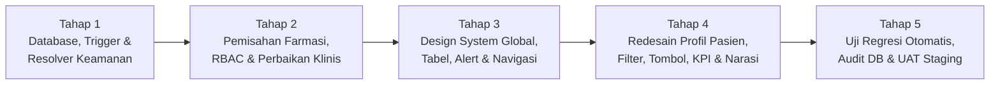

# 00 — MASTER EXECUTION BLUEPRINT (PRE-RELEASE & SATUSEHAT-READY)
**Proyek:** Aplikasi Rekam Medis Elektronik (RME) Klinik Pratama (Poli Umum & Poli Gigi)  
**Dokumen:** Ringkasan Eksekutif, Matriks Prioritas P0/P1/P2, Tahapan Eksekusi & Checklist UAT Pra-Integrasi SATUSEHAT  
**Status Saat Ini:** Fase Perencanaan Final Selesai (100% Read-Only Audit — Menunggu Persetujuan Eksekusi Kode)

---

## 1. Indeks Dokumen Perencanaan Spesialis

Seluruh temuan inspeksi kode nyata (*zero assumption*) dan spesifikasi teknis telah disusun secara mendalam pada 4 dokumen spesialis pendamping berikut:
1. **[01-clinical-regulatory-audit.md](./01-clinical-regulatory-audit.md)** — *Peran 1 (Clinical & Regulatory Architect)*: Kamus 37 perbaikan narasi klinis baku, audit komparatif 9 sub-modul Dokter Poli Umum vs Dokter Poli Gigi, kolaborasi tindakan Dokter–Perawat, audit hukum *General Consent* & Pelepasan Informasi sesuai PMK 24/2022, spesifikasi klinis Dokumen Pasien, dan kesiapan entitas HL7 FHIR R4 SATUSEHAT.
2. **[02-rbac-menu-and-flow-audit.md](./02-rbac-menu-and-flow-audit.md)** — *Peran 2 (Product & RBAC Flow Auditor)*: Arsitektur pemisahan total akun & depo Farmasi Poli Umum vs Farmasi Poli Gigi, audit matriks seluruh menu/rute/tombol untuk ke-5 role (8 profil penugasan), matriks RBAC granular fitur Dokumen Pasien, serta perbaikan sistemik *breadcrumb* dan tombol `Back` kontekstual.
3. **[03-ui-ux-design-system-and-screens.md](./03-ui-ux-design-system-and-screens.md)** — *Peran 3 (Principal UI/UX & Design System Engineer)*: Spesifikasi redesain 2-kolom Screen Profil Pasien & seluruh screen profil, inventarisasi 74 tabel beserta kelengkapan filter (termasuk *Reservasi 7 Hari ke Depan* & *Kalender Libur Praktik*), perbaikan cacat *hover* & *dark mode*, standarisasi tunggal `Alert`/`Toast` (*Close X* + *auto-dismiss*), penataan seluruh tombol (`justify-end` & header rapi), serta penambahan *Card Total* pada *Laporan Pengkajian Awal* dan seluruh laporan.
4. **[04-technical-architecture-and-db-plan.md](./04-technical-architecture-and-db-plan.md)** — *Peran 4 (Lead Full-Stack & Database Architect)*: Rancangan 3 migrasi database aditif + proteksi trigger imutabilitas SQLite/PostgreSQL, integrasi *Private Storage* & `ClinicalBackup` terenkripsi, arsitektur keamanan 3-lapis backend, spesifikasi 8 komponen React *reusable*, serta pengamanan invariansi 624 pengujian PHPUnit & 312 pengujian SSR.

---

## 2. Ringkasan Eksekutif & Temuan Paling Kritikal

Secara arsitektural, aplikasi RME Klinik Pratama telah memiliki fondasi keamanan yang kuat (versi catatan ber-SHA-256, trigger anti-hapus RME, sesi klinis ketat, dan kerangka kolom awal SATUSEHAT). Namun, audit menyeluruh mengidentifikasi **celah kritikal (P0)** pada kepatuhan klinis/hukum, isolasi akses antar-poli, keutuhan data pengodean, dan konsistensi antarmuka pengguna yang **wajib diselesaikan sebelum masuk ke tahap Uji Coba (Staging) & Integrasi Live SATUSEHAT**.

---

## 3. Matriks Prioritas Terpadu (P0 / P1 / P2)

### Prioritas P0 — Blocker Kepatuhan Regulasi, Keamanan RBAC, Integritas Klinis & Cacat Fungsional Utama

| Kode | Domain | Ringkasan Temuan & Lokasi File Aktual | Target Solusi |
| :--- | :--- | :--- | :--- |
| **P0-01** | RBAC & Farmasi | **Akun & Stok Farmasi Belum Terpisah Per Poli:** Satu akun `farmasi` masih mengakses antrean, dispensing, telaah klinis, obat langsung, dan stok gabungan Poli Umum & Poli Gigi (`PharmacyStaffAccess.php`, `FarmasiController.php`, `PersediaanRecorder.php`, `pharmacy-clinic-tabs.tsx`). Field `poliklinik_id` bahkan disembunyikan bagi jabatan `farmasi` di `master/nakes/index.tsx:65` & `users/index.tsx:141`. | Wajibkan `poliklinik_id` pada akun/Nakes Farmasi, bangun `App\FarmasiClinicResolver`, pisahkan depo `DEPO-PU` & `DEPO-PG`, tambahkan `poliklinik_id` + `depo_id` ke `farmasi_mandiris`, kunci seluruh query/policy farmasi per poli, dan sediakan filter poli pada pengawasan stok Admin. |
| **P0-02** | Regulasi PMK 24/2022 | **Penolakan *General Consent* (`refused`) Lolos Gerbang Pelayanan:** `GeneralConsentService.php:122` dan `screening/show.tsx:730` mengizinkan pasien non-darurat yang **menolak** persetujuan umum tetap diproses hingga pemeriksaan dokter & farmasi; sementara tautan bukti verifikasi gagal `404` pada kunjungan lintas poli berikutnya (`GeneralConsentController.php:147`). | Blokir alur elektif bila status `'refused'` (kecuali alasan gawat darurat tercatat), tambahkan klausul SATUSEHAT ke naskah consent, dan ubah otorisasi verifikasi consent berbasis hak akses pasien. |
| **P0-03** | Medikolegal Dokter | **Surat Medis Ber-QR & Resep Luar Bertanda Tangan Terbit Sebelum RME Final:** `PemeriksaanController.php:1108` (`storeSurat`) dan `PersuratanController.php:265` (`printPrescription`) mengizinkan penerbitan surat resmi & cetakan resep luar lengkap dengan gambar tanda tangan dokter saat pemeriksaan masih **draf (`signed_at === null`) dan tanpa PIN**! | Wajibkan RME telah ditandatangani (`signed_at !== null`) + verifikasi `ClinicalSigningCredential` (PIN 6 digit) sebelum surat medis maupun resep luar bertanda tangan dapat diterbitkan/dicetak. |
| **P0-04** | Klinis & Kesinambungan RME | **Silo / Kebutaan RME Lintas Poli & Error 403 Pasien Baru:** `PasienController.php:735–741` memblokir dokter melihat kunjungan pasien yang belum diklaim (`403`) maupun riwayat RME dari poli perujuk saat menerima **Rujukan Internal** (Poli Umum $\leftrightarrow$ Poli Gigi). | Selaraskan `authorizedVisits()` & `KunjunganPolicy::viewClinical()` dengan `DoctorAccessService` serta buka akses baca longitudinal RME lintas poli bagi dokter pemeriksa aktif dengan audit penuh. |
| **P0-05** | Integritas Data & SATUSEHAT | **Koreksi Coding Tidak Meng-update Tabel `diagnosa`, Resep Tanpa Signa & Alergi Basi:** (1) `DiagnosisCodingCorrectionController.php:101–126` tidak meng-update `Diagnosa` model (`kode_icd10` tetap `NULL`); (2) `PemeriksaanController.php:848` membiarkan `aturan_pakai` kosong (`nullable`); (3) `PatientAllergyHistory.php:97` tidak menonaktifkan alergi lama saat dikoreksi; (4) Poli Gigi tidak memiliki `kondisi_akhir` & `disposisi`. | Update baris `Diagnosa` saat koreksi coding, wajibkan `aturan_pakai`, nonaktifkan alergi lama yang dikoreksi, dan aktifkan `kondisi_akhir` + `disposisi` pada Poli Gigi. |
| **P0-06** | Klinis & RBAC Dokumen | **Fitur Dokumen Pasien Longitudinal Belum Ada & Dokter Terkunci `403`:** `VisitAttachmentController.php:150–155` memblokir dokter (`403`) mengunggah berkas penunjang dan mengunci lampiran begitu skrining selesai (`409`). | Bangun tabel & modul `patient_documents` pada *Private Storage* (`documents/patients/{id}`), terintegrasi `ClinicalBackup`, dengan pratinjau `inline`, unduh, dan *soft-archive* wajib alasan $\ge 10$ karakter. |
| **P0-07** | Keamanan RBAC & Rute Rusak | **Kebocoran Data Lintas Poli & Rute Ekspor 404:** (1) `RegistrationController.php:659` (`laporanTopDiagnosa`) membocorkan diagnosis Poli Gigi ke Perawat Poli Umum; (2) `RegistrationController.php:843` mengizinkan jadwal dokter salah poli; (3) Tombol `Ekspor Excel` di `stok/persediaan/index.tsx:31` mengarah ke `/stok/export` yang **404 Not Found**. | Kunci filter poli perawat pada `laporanTopDiagnosa`, validasi poli jadwal terhadap poli Nakes dokter, dan buat rute `stok.persediaan.export` resmi untuk Admin & Farmasi. |
| **P0-08** | UI/UX Profil, Tabel, Alert & Tombol | **Target Utama Standarisasi Antarmuka:** (1) Redesain 2-kolom **Profil Pasien** (`pelayanan/pasien/show.tsx` + perbaikan penghapusan biodata di `PasienController.php:266`); (2) Filter wajib pada **Reservasi 7 Hari ke Depan** & **Kalender Libur Praktik**; (3) Teks putih-di-atas-putih pada *dark mode* etiket obat (`farmasi/show.tsx:343`) & tabrakan hover tabel (`app.css:145`, `table.tsx:21`); (4) Standarisasi tunggal `Alert`/`Toast` (**Close X** + **auto-dismiss**); (5) Penempatan tombol kanan (`Simpan Register` di `pelepasan.tsx:62`) & perbaikan tombol melayang di atas judul (`general-consent.tsx:36`, `farmasi/show.tsx:201`); (6) Penambahan **Card Total** pada **Laporan Pengkajian Awal** (`screening/history.tsx`). | Implementasikan 8 komponen *reusable* Design System dan terapkan secara konsisten di seluruh layar target. |

### Prioritas P1 — Penyempurnaan Alur Klinis, Kelengkapan Filter/KPI & Navigasi Kontekstual

| Kode | Domain | Ringkasan Perbaikan |
| :--- | :--- | :--- |
| **P1-01** | Klinis Dokter & Perawat | Aktifkan praisi RPS dari pengkajian perawat (Umum & Gigi), input pengukuran ulang TTV dokter, input OHI-S & perluasan 25 kode cepat ICD-10 gigi, input `surfaces` pada tindakan gigi, tampilan `review_of_systems` & penghapusan duplikasi `riwayat_obat` di Adendum, pembaruan otomatis snapshot `RujukanInternal` saat `selesai()`, pencatatan `started_at` & `can_delegate_to_nurse` pada tindakan, serta pencantuman BB/Alergi/Kota dinamis pada cetakan Resep Luar. |
| **P1-02** | RBAC & Navigasi | Hapus menu `Diagnosis terbanyak` dari sidebar `pendaftaran`, hapus menu duplikat `Data pasien` dari sidebar `farmasi`, sembunyikan tombol aksi mati (*disabled*) pada tabel lintas role, daftarkan 7 judul halaman yang hilang di `app-layout.tsx`, bersihkan ID database mentah dari *breadcrumb*, dan terapkan `ContextualBackUrl` + tombol `Kembali` seragam di seluruh halaman. |
| **P1-03** | UI/UX Global | Seragamkan layout 2-kolom pada Profil Akun (`profile/show.tsx`) & Pengaturan Klinik (`setting/index.tsx`); lengkapi filter pada Stok Dokter, Kartu Stok, Kunjungan Dokter, Diagnosis Terbanyak, Persuratan, Rujukan Internal, dan Laporan; ganti 20+ kotak pesan kustom dengan `<Alert>` standar; perbaiki seluruh tombol submit yang masih rata kiri; tambahkan Card Total reaktif filter pada Diagnosis Terbanyak Dokter, Laporan Kunjungan Pendaftaran, Audit Log, serta perbaiki proporsi 5 kartu di Dasbor Perawat & Farmasi. |
| **P1-04** | Narasi & SATUSEHAT | Terapkan seluruh 37 perbaikan kamus narasi klinis baku (termasuk penyatuan label `PIN Pengesahan Klinis`), serta hubungkan *"Dark Columns"* SATUSEHAT (kode wilayah di Pengaturan Klinik & Pasien, `ruang_poli_id` otomatis pada Kunjungan, KFA POA/POV di Master Obat, dan `days_supply` di Farmasi). |

### Prioritas P2 — Peningkatan Kualitas Tambahan & Kesiapan Konektor Masa Depan

| Kode | Domain | Ringkasan Perbaikan |
| :--- | :--- | :--- |
| **P2-01** | Klinis Lanjutan | Klasifikasi kasus diagnosis `Baru` vs `Lama` untuk pelaporan morbiditas, mekanisme *Jawaban Konsultasi Balik* pada rujukan internal, reset nomor urut surat medis per tahun kalender, dan templat *Surat Keterangan Kesehatan Gigi & Mulut*. |
| **P2-02** | UI & Infrastruktur | Konversi tampilan daftar `div` pada `pelepasan.tsx` & `kualifikasi-farmasi.tsx` ke `<DataTableWrapper>`, perapihan aksi baris ke `<ActionButton>`, serta penyiapan kerangka `config/satusehat.php` (non-aktif secara default sampai kredensial *sandbox/production* siap). |

---

## 4. Peta Tahapan Eksekusi (5 Sprint Terstruktur)

1. **Tahap 1 — Database, Trigger Imutabilitas & Layanan Fondasi:**
   - Migrasi `poliklinik_id`/`depo_id` farmasi, tabel `patient_documents`, kolom kelengkapan profil/klinis/SATUSEHAT, pemulihan trigger SQLite, `CheckClinicalSecurity`, `ClinicalBackup`, `FarmasiClinicResolver`, dan pembaruan `KemenparPreReleaseSeeder`.
2. **Tahap 2 — Backend RBAC, Isolasi Farmasi Poli Umum vs Gigi & Logika Klinis:**
   - Isolasi penuh seluruh controller & laporan Farmasi + stok per poli/depo, pembuatan `PatientDocumentController` & `PatientDocumentPolicy`, penutupan seluruh celah P0/P1 pemeriksaan dokter, *General Consent*, pelepasan informasi, rujukan internal, dan jadwal dokter.
3. **Tahap 3 — Komponen Reusable Design System & Kerangka Layout Global:**
   - Perbaikan CSS token *dark mode* & tabel, penyatuan `Alert` + `Toaster` (*Close X* & *auto-dismiss*), pembangunan `PageHeaderWithActions`, `FormActionFooter`, `TableFilterBar`, `DataTableWrapper`, `SummaryStatGrid`, `PatientProfileLayout`, `DocumentUploaderModal`, serta perbaikan *breadcrumb* & navigasi sidebar.
4. **Tahap 4 — Implementasi Per Screen, Profil Pasien, Filter Tabel, Tombol, KPI & Narasi:**
   - Redesain Screen Profil Pasien & screen profil lainnya, penerapan filter pada seluruh tabel wajib, penataan seluruh tombol ke standar kanan/header, penambahan Card Total pada *Laporan Pengkajian Awal* dan laporan lainnya, serta standarisasi narasi klinis global.
5. **Tahap 5 — Verifikasi Menyeluruh, Pengujian Regresi & Persiapan Staging:**
   - Penambahan pengujian otomatis fitur baru, eksekusi penuh PHPUnit (SQLite & PostgreSQL), Node SSR render & session test, TypeScript check, Vite build, dan Laravel Pint.

---

## 5. Checklist Kesiapan UAT Pra-Rilis & Pra-Integrasi SATUSEHAT

### A. Checklist Fungsional, Klinis & RBAC
- [ ] **Isolasi Farmasi Poli Umum vs Poli Gigi:** Login sebagai `apoteker.umum@kemenpar.go.id` hanya menampilkan antrean resep, telaah klinis, obat langsung, mutasi batch `DEPO-PU`, dan laporan Poli Umum; mengakses URL kunjungan Poli Gigi mengembalikan `404`. Berlaku simetris untuk `apoteker.gigi@kemenpar.go.id` (`DEPO-PG`).
- [ ] **Pengawasan Admin:** Admin dapat memfilter stok Poli Umum vs Poli Gigi dan mengunduh Excel persediaan tanpa error `404`, namun tetap ditolak `403` saat membuka isi klinis RME/resep pasien.
- [ ] **Kepatuhan *General Consent* & Pelepasan Informasi:** Pasien non-darurat dengan keputusan `'refused'` tertahan sebelum skrining keperawatan; bukti verifikasi consent dapat dibuka pada kunjungan ke-2 di poli berbeda tanpa `404`; cakupan pelepasan informasi mencakup salinan RME, lab, dan rontgen gigi.
- [ ] **Pemeriksaan Dokter Poli Umum & Poli Gigi:** Pengesahan RME, Surat Medis, dan Resep Luar wajib melalui PIN Pengesahan Klinis setelah RME ditandatangani; `aturan_pakai` resep wajib terisi; koreksi pengodean ICD-10 memperbarui tabel `diagnosa`; dokter poli penerima rujukan internal dapat membaca riwayat RME poli pengirim.
- [ ] **Dokumen Eksternal Pasien:** Unggah berkas PDF/JPG/PNG ($\le 10$ MB) dari Profil Pasien berjalan untuk Admin, Perawat, dan Dokter sesuai matriks RBAC; pratinjau *inline* dan unduh memverifikasi SHA-256 dan mencatat audit; pengarsipan wajib mengisi alasan $\ge 10$ karakter tanpa menghapus berkas fisik.

### B. Checklist Standar UI/UX & Design System
- [ ] **Screen Profil Pasien & Screen Profil Lainnya:** Layout 2 kolom (`~31%` kiri / `~69%` kanan) tampil proporsional di desktop & responsif di tablet/mobile; biodata kiri tetap utuh saat berpindah bagian; tab kunjungan mendatang/riwayat, filter kanan atas, Card Dokumen Pasien, dan Card Catatan Medis berfungsi penuh.
- [ ] **Tabel Data, Filter & Dark Mode:** *Reservasi 7 Hari ke Depan*, *Kalender Libur Praktik*, Stok Dokter, Kartu Stok, dan seluruh tabel utama memiliki filter relevan yang fungsional; tidak ada teks/badge yang hilang saat *hover* maupun pada *dark mode* (termasuk pratinjau etiket obat).
- [ ] **Alert / Toast & Sistem Tombol:** Seluruh pesan memiliki tombol **Close (X)** dan *auto-dismiss* sesuai durasi; tombol `Simpan Register` di Pelepasan Informasi dan seluruh tombol submit form berada di sebelah kanan (`justify-end`); tidak ada lagi tombol melayang di atas judul halaman (`Persetujuan Umum`, `Penyerahan Obat`); tombol `Kembali` seragam dan akurat secara konteks.
- [ ] **Card Total Laporan & Narasi Klinis:** *Laporan Pengkajian Awal* dan seluruh laporan menampilkan Card Total proporsional yang berubah dinamis mengikuti filter aktif; tidak ada lagi istilah teknis/campur-aduk bahasa (`unresolved`, `Kata sandi akun` untuk PIN, `Diagnosa`, dll.).

### C. Checklist Kesiapan Arsitektur SATUSEHAT & Keamanan Teknis
- [ ] Seluruh entitas inti memiliki pemetaan data bersih menuju resource FHIR SATUSEHAT (`Organization`, `Location` + `ruang_poli_id`, `Patient` NIK 16 digit + kode wilayah, `Practitioner` NIK/IHS, `Consent` opt-in/opt-out, `Encounter` timestamps + disposisi kedua poli, `Observation` TTV & Odontogram, `Condition` ICD-10 terverifikasi, `Procedure` ICD-9-CM + `surfaces`, `Medication*` KFA + signa, `AllergyIntolerance`, dan `DocumentReference`).
- [ ] `php artisan clinic:security-check --json` dan `php artisan clinic:audit-database` lulus `0` temuan pada SQLite & PostgreSQL; `ClinicalBackup` mengenkripsi dan memverifikasi berkas `patient_documents`; seluruh pengujian otomatis PHPUnit, Frontend SSR, TypeScript (`tsc --noEmit`), dan Vite build lulus 100%.
