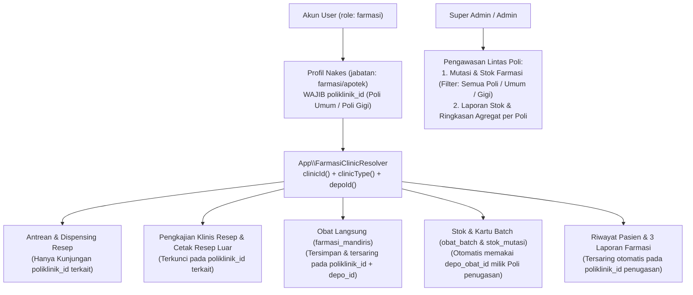

# 02 — Audit Produk, Alur Bisnis, RBAC Per Role & Navigasi
**Peran:** Product & RBAC Flow Auditor (Analis Bisnis, Hak Akses Per Role, Pemisahan Farmasi & Navigasi)  
**Mode Audit:** 100% Read-Only Codebase Inspection (Zero Assumption)

---

## 1. Arsitektur Pemisahan Total Akun & Akses Farmasi / Apoteker (Poli Umum vs Poli Gigi)

### 1.1 Hasil Audit Kondisi Saat Ini (Mengapa Satu Akun Farmasi Masih Mengakses Semua Poli)
Berdasarkan inspeksi langsung pada `app/PharmacyStaffAccess.php`, `app/AdminPharmacyAssistance.php`, `app/PersediaanRecorder.php`, `app/Http/Middleware/HandleInertiaRequests.php`, `app/Http/Controllers/FarmasiDashboardController.php`, `app/Http/Controllers/Pelayanan/FarmasiController.php`, `app/Http/Controllers/FarmasiMandiriController.php`, `app/Http/Controllers/PharmacyClinicalReviewController.php`, `app/Http/Controllers/Stok/PersediaanController.php`, `app/Http/Controllers/Master/NakesController.php`, `app/Http/Controllers/UserController.php`, dan `resources/js/components/dashboard/pharmacy-clinic-tabs.tsx`:

1. **Ketiadaan Penugasan Poli Wajib pada Profil Nakes & Akun `farmasi`:**
   - Di `app/Models/User.php:18`, `User::SINGLE_ACTIVE_ROLES = ['admin', 'pendaftaran']`, sehingga database **sudah mengizinkan banyak akun `farmasi` aktif**. Namun `KemenparPreReleaseSeeder.php:151` hanya membuat 1 akun bersama (`apoteker@kemenpar.go.id`).
   - Di `app/Http/Controllers/Master/NakesController.php:35–37, 120, 191`, validasi `poliklinik_id` hanya diwajibkan bagi `dokter,perawat,bidan,terapis_gigi` dan **mengabaikan `farmasi`/`apotek`**. Bahkan di `resources/js/pages/master/nakes/index.tsx:65–66, 227–237` serta `resources/js/pages/users/index.tsx:141`, dropdown `Poliklinik penugasan` **disembunyikan secara paksa** ketika jabatan/peran adalah `farmasi`!
   - Di `app/Http/Controllers/UserController.php:118, 154, 290–321`, `poliklinik_id` hanya divalidasi dan disinkronkan ke `Nakes` untuk `role === 'perawat'`.
   - Tidak ada layanan resolver poli farmasi (berbeda dengan `PerawatClinicResolver` di `app/PerawatClinicResolver.php` dan `DoctorAccessService` di `app/DoctorAccessService.php`). `PharmacyStaffAccess::current()` (`app/PharmacyStaffAccess.php:11–29`) sama sekali tidak memeriksa `poliklinik_id`.
2. **Antrean, Dispensing, Telaah Resep, & Resep Luar Terbuka Lintas Poli:**
   - Komponen `PharmacyClinicTabs` (`resources/js/components/dashboard/pharmacy-clinic-tabs.tsx:4–30`) menampilkan tab bebas `Semua poli | Poli Umum | Poli Gigi` pada Dasbor Farmasi, Penyerahan Obat, Resep Luar, dan Riwayat Farmasi Pasien.
   - `AdminPharmacyAssistance::authorizeVisit()` (`app/AdminPharmacyAssistance.php:18–24`), `FarmasiController::show/store/markExternal/selesai` (`app/Http/Controllers/Pelayanan/FarmasiController.php:296–585`), `PharmacyClinicalReviewController::show/store` (`lines 22–102`), dan `PersuratanController::printPrescription` (`line 264`) hanya memeriksa `$user->role === 'farmasi'` tanpa memverifikasi kesesuaian `kunjungan.poliklinik_id` dengan poli penugasan apoteker!
   - `HandleInertiaRequests::pendingHandovers()` (`app/Http/Middleware/HandleInertiaRequests.php:149–153`) menghitung seluruh kunjungan berstatus `farmasi` dari Poli Umum + Poli Gigi secara gabungan pada badge sidebar.
3. **Pemberian Obat Langsung (`FarmasiMandiri`) Tanpa Kolom Poli/Depo:**
   - Tabel `farmasi_mandiris` (`app/Models/FarmasiMandiri.php`) tidak memiliki `poliklinik_id` maupun `depo_id`, sehingga seluruh transaksi obat langsung bercampur lintas poli.
4. **Manajemen Stok & Batch (`ObatBatch` & `PersediaanRecorder`) Masih Global Tanpa Isolasi Depo Poli:**
   - Tabel `poliklinik` sudah memiliki kolom `depo_obat_id` (`Poliklinik.php:17`), dan `obat_batch` serta `stok_mutasi` sudah memiliki kolom `depo_id`.
   - **Namun**, di `KemenparPreReleaseSeeder.php:83–95` baik Poli Umum maupun Poli Gigi diarahkan ke satu `DEPO-KP-01` yang sama; `PersediaanController::receive()` (`PersediaanController.php:71–80`) menyimpan batch baru dengan `depo_id = null`; dan `PersediaanRecorder::issue()` (`PersediaanRecorder.php:40`) memotong batch berdasarkan FEFO dari seluruh klinik tanpa memfilter `depo_id` poli asal!
5. **Bug Query pada Laporan Resep Luar Farmasi (`FarmasiController.php:201–206`):**
   - `externalReportQuery()` memfilter `whereHas('farmasiResepLuar', fn ($q) => $q->where('petugas_id', $id))` untuk akun non-admin, yang secara tidak sengaja **menghilangkan seluruh resep luar yang ditulis langsung oleh dokter (`is_resep_luar = true`)** dari laporan apoteker!

### 1.2 Rancangan Arsitektur Pemisahan Berbasis Penugasan Poli (Farmasi Poli Umum vs Farmasi Poli Gigi)

1. **Penugasan Akun & Resolver Terpusat (`App\FarmasiClinicResolver`):**
   - Wajibkan `poliklinik_id` (Poli Umum atau Poli Gigi aktif) untuk jabatan `farmasi` & `apotek` di `NakesController`, `UserController`, `master/nakes/index.tsx`, dan `users/index.tsx`.
   - Buat layanan `App\FarmasiClinicResolver` (identik pola keamanannya dengan `PerawatClinicResolver`): memvalidasi 1 profil `Nakes` aktif dengan `poliklinik_id` aktif (`jenis` `umum` atau `gigi`), mengembalikan `clinicId()`, `clinicType()`, dan `depoId()` (`poliklinik.depo_obat_id`), serta melempar `403` bila akun belum memiliki penugasan poli aktif.
   - Bagikan `auth.user.clinicType` dan `auth.user.clinicName` di `HandleInertiaRequests.php` untuk `dokter`, `perawat`, **dan `farmasi`** (misal label akun menjadi *"Farmasi · Poli Umum"* dan *"Farmasi · Poli Gigi"*), serta saring badge `pharmacyQueues.handovers` hanya pada `poliklinik_id` penugasan.
   - Perbarui `KemenparPreReleaseSeeder.php` agar menyediakan 2 akun terpisah: `apoteker.umum@kemenpar.go.id` (Poli Umum, `DEPO-PU`) dan `apoteker.gigi@kemenpar.go.id` (Poli Gigi, `DEPO-PG`).
2. **Isolasi Otomatis Depo & Stok Per Poli (Tanpa Membuka Kembali Menu Master Depo yang Telah Dipensiunkan):**
   - Pastikan setiap poliklinik aktif (`Poli Umum` dan `Poli Gigi`) otomatis memiliki 1 baris `DepoObat` terikat (`poliklinik.depo_obat_id`). *(Catatan kompatibilitas arsitektur: rute `/master/depo-obat` tetap 404 dan prop `depots` tidak diekspos agar tetap patuh pada `SimplifiedClinicModulesTest`)*.
   - Saat Apoteker Poli Umum/Gigi menerima batch, melakukan opname, rekonsiliasi karantina, retur, pengeluaran resep (`FarmasiController::selesai`), atau obat langsung (`FarmasiMandiriController::store`), `PersediaanRecorder` mengunci transaksi pada `depo_id` milik poli penugasannya (serta menjaga invarian `obat.stok = SUM(seluruh batch)`). Pemakaian BHP tindakan dokter/perawat (`VisitCareWorkflow::consumeSupplies`) dan pengecekan stok di ruang periksa dokter (`PemeriksaanController` & `DokterDashboardController::stock`) juga membaca stok layak pakai pada depo poli terkait!
3. **Penghapusan Tab Lintas-Poli bagi Farmasi & Pengawasan Admin:**
   - Hapus/sembunyikan `<PharmacyClinicTabs>` bagi akun `farmasi` karena setiap akun sudah terikat mutlak pada 1 poli (diganti *badge* identitas poli aktif di header halaman).
   - Kunci seluruh endpoint baca/tulis (`FarmasiDashboardController`, `FarmasiController`, `PharmacyClinicalReviewController`, `FarmasiMandiriController`, `PersuratanController::printPrescription`, `PasienController::authorizedVisits`, dan ke-3 laporan farmasi) pada `poliklinik_id = FarmasiClinicResolver::clinicId($user)` (mengembalikan `404` bila mencoba mengakses ID kunjungan poli seberang lewat URL).
   - **Hak Pengawasan Admin:** Admin tetap tidak mengakses identitas klinis resep pasien (sesuai `RoleBoundaryTest`), namun pada `/stok/persediaan` dan `/laporan/stok` Admin memiliki filter **Unit Poliklinik (`Semua Poli | Poli Umum | Poli Gigi`)** untuk memantau saldo fisik, stok menipis, kedaluwarsa, serta menerima distribusi stok ke poli tujuan.

---

## 2. Audit Menyeluruh Per Role & Per Menu (Matriks Akses & Logika Alur)

Catatan struktur *role* saat ini (`app/Models/User.php:16`): aplikasi memiliki **5 peran login** (`admin`, `pendaftaran`, `perawat`, `dokter`, `farmasi`), yang secara operasional terbagi menjadi **8 profil penugasan** (Admin/Manajemen, Pendaftaran, Perawat Poli Umum, Perawat Poli Gigi, Dokter Poli Umum, Dokter Poli Gigi, Farmasi Poli Umum, Farmasi Poli Gigi). Tidak ada role login terpisah untuk `kepala_klinik`; fungsi laporan eksekutif/manajemen agregat berada pada role `admin` (`/admin/laporan`, `/laporan/kunjungan`, `/laporan/stok`).

### 2.1 Temuan Kritis Ketidaksesuaian Menu, Tombol & Rute Per Role

| Peran | Lokasi Menu / Halaman / Rute | Temuan Masalah (Relevansi / Menu Hilang / Tombol Bocor / Dead-End) | Rencana Perbaikan |
| :--- | :--- | :--- | :--- |
| **Admin** | `stok/persediaan/index.tsx:31` | **[P0 — Broken 404 Link]** Tombol `Ekspor Excel` mengarah ke `/stok/export?...` yang **tidak terdaftar di `routes/web.php`** (rute sebenarnya adalah `/laporan/stok/export`). | Arahkan ke rute ekspor stok yang valid dan sediakan endpoint ekspor persediaan yang terotorisasi untuk `admin` & `farmasi`. |
| **Admin** | `routes/web.php:164, 254, 274, 297, 308, 340, 347` vs `KunjunganPolicy.php:15–26` | **[P1 — Kontradiksi Rute vs Policy]** `EnsureRole` mengizinkan `admin` di rute skrining, pemeriksaan, tindakan, farmasi, lampiran, dan RME, tetapi `ProtectClinicalInformation` + `KunjunganPolicy` langsung memblokir `admin` dengan `403`, membuat `adminQueues` (`HandleInertiaRequests.php:80–96`) dan kode bantuan draf tidak sinkron. | Bersihkan *badge* antrean klinis yang tidak dapat dibuka dari `app-layout.tsx:413–418` & selaraskan middleware rute dengan batas kerahasiaan klinis `RoleBoundaryTest`. |
| **Admin** | `routes/web.php:150` (`admin.laporan.tindakan-perawat.cetak`) | **[P2 — Salah Handler]** Rute bernama `.cetak` justru mengarah ke `AggregateClinicalReportController@export` (mengunduh Excel, bukan tampilan cetak). Selain itu `AdminReportController.php:18–23` tidak menautkan ke sub-laporan `/admin/laporan/pengkajian`, `/pemeriksaan`, `/dokter/{jenis}`. | Rapikan tautan kartu pada `/admin/laporan` agar seluruh laporan agregat klinis dapat diakses dari satu pintu tanpa *orphan route*. |
| **Admin** | `RegistrationController.php:843–870` (`storeJadwalPraktik`) | **[P0 — Celah Kebocoran Lintas Poli]** Admin dapat menjadwalkan Dokter Poli Umum ke Poli Gigi tanpa validasi kecocokan `nakes.poliklinik_id`, yang membuat `DoctorAccessService` membocorkan antrean poli seberang! | Wajibkan validasi `jadwal_dokter.poliklinik_id === dokter.poliklinik_id` saat tambah/ubah jadwal maupun pengecualian jadwal. |
| **Pendaftaran** | Sidebar `Laporan -> Diagnosis terbanyak` (`app-layout.tsx:128`) | **[P1 — Menu Klinis Tidak Relevan]** Petugas loket pendaftaran melihat dan mengekspor peringkat diagnosis klinis ICD-10 (`/pendaftaran/laporan-top-diagnosa`). | Hapus menu `Diagnosis terbanyak` dari sidebar `pendaftaran` (cukup `Laporan kunjungan` operasional); pindahkan laporan diagnosis agregat ke `admin` & `dokter`/`perawat`. |
| **Pendaftaran** | `persuratan/pelepasan.tsx:60` | **[P1 — Salah Label Kredensial]** Meminta `"PIN tanda tangan klinis / kata sandi petugas"`, padahal akun `pendaftaran` tidak mendukung pembuatan PIN di `/profile`. | Tampilkan label `'Kata sandi akun petugas'` khusus saat login sebagai `pendaftaran`, dan `'PIN Pengesahan Klinis'` saat login sebagai `dokter`. |
| **Perawat (Umum & Gigi)** | Sidebar `Laporan -> Diagnosis terbanyak` (`RegistrationController.php:651–722`) | **[P0 — Kebocoran Data Lintas Poli]** Controller `laporanTopDiagnosa` tidak memfilter `PerawatClinicResolver::clinicId()`, sehingga Perawat Poli Umum dapat melihat dan mengekspor diagnosis Poli Gigi (dan sebaliknya)! | Terapkan `poliklinik_id = PerawatClinicResolver::clinicId($user)` secara paksa pada query & ekspor `laporanTopDiagnosa` ketika diakses oleh `perawat`. |
| **Perawat (Umum & Gigi)** | `perawat/dashboard.tsx:108`, `kunjungan-per-poli.tsx:186–188`, `pelayanan/pasien/index.tsx:158` | **[P1 — Navigasi Ganda & Tombol Disabled Mengganggu]** Pintasan *"Data pasien"* di dasbor perawat lari ke `/pendaftaran/database-pasien` (berbeda dari sidebar `/pelayanan/pasien` dan menampilkan tombol `Edit` mati). Di `kunjungan-per-poli.tsx` dan `pasien/index.tsx`, muncul tombol `Edit`, `Batalkan`, `Cetak antrean`, dan `Verifikasi` dalam kondisi *disabled* di setiap baris! | Arahkan pintasan dasbor perawat ke `/pelayanan/pasien` dan sembunyikan tombol aksi administratif (`Edit kunjungan`, `Batalkan`, `Cetak antrean`, `Verifikasi kepesertaan`) bagi peran yang tidak pernah memiliki wewenang tersebut. |
| **Perawat (Umum & Gigi)** | `HandleInertiaRequests.php:47–48, 68` | **[P2 — Konteks Poli Absen di UI]** `auth.user.clinicType` hanya diisi untuk `dokter`, sehingga akun perawat tidak menampilkan penanda *"Perawat · Poli Umum"* / *"Perawat · Poli Gigi"* di sidebar. | Isi `clinicType` dan `clinicName` untuk `perawat`, `dokter`, dan `farmasi` di `HandleInertiaRequests.php`. |
| **Dokter (Umum & Gigi)** | `PasienController.php:735–737` (`authorizedVisits`) | **[P0 — Dead-End 403 Pasien Baru & Rujukan]** `authorizedVisits()` hanya mengecek `dokter_id = $this->doctorId()`, mengabaikan kunjungan belum diklaim (`DoctorAccessService::visibleVisits`) serta riwayat rujukan lintas poli. Dokter mendapat `403` saat membuka Profil/RME pasien baru sebelum klik `Ambil alih` atau saat menerima rujukan dari poli lain! | Selaraskan `PasienController::authorizedVisits()` & `KunjunganPolicy::viewClinical()` dengan `DoctorAccessService` + akses baca longitudinal RME pasien yang sedang ditangani dokter. |
| **Dokter (Umum & Gigi)** | `dokter/stock.tsx` (`DokterDashboardController.php:329–354`) | **[P1 — Tanpa Filter & Belum Per Poli]** Tabel `/dokter/stok-obat` tidak memiliki kolom pencarian maupun filter jenis/status stok, serta menampilkan stok global. | Tambahkan `FilterPanel` (`Cari obat`, `Jenis`, `Status ketersediaan`) dan tampilkan stok layak pakai sesuai depo poliklinik dokter. |
| **Dokter (Umum & Gigi)** | `routes/web.php:255–261` & `VisitAttachmentController.php:150` | **[P0 — Fitur Terblokir]** Dokter diblokir `403` untuk mengunggah berkas penunjang pasien selama pemeriksaan berlangsung. | Buka hak unggah, pratinjau, unduh, dan arsip beralasan bagi `dokter` melalui modul `PatientDocumentController` baru. |
| **Farmasi (Umum & Gigi)** | Sidebar `Pengelolaan obat -> Data pasien` (`app-layout.tsx:187`) | **[P1 — Menu Duplikat Redirect]** Sidebar memiliki `Riwayat farmasi pasien` (`/farmasi/pasien`) **sekaligus** `Data pasien` (`/pelayanan/pasien`) yang langsung melakukan HTTP redirect kembali ke `/farmasi/pasien` (`PasienController.php:45–47`)! | Hapus item duplikat `Data pasien` (`/pelayanan/pasien`) dari grup `Pengelolaan obat` pada sidebar `farmasi`. |
| **Farmasi (Umum & Gigi)** | `stok/persediaan/index.tsx:31` | **[P0 — Broken 404 Link]** Tombol `Ekspor Excel` pada halaman persediaan menghasilkan `404 Not Found`, sementara `/laporan/stok/export` dikunci hanya untuk `admin`. | Sediakan rute ekspor persediaan (`stok.persediaan.export`) yang terotorisasi untuk `admin` dan `farmasi` (tersaring otomatis pada depo poli masing-masing). |

### 2.2 Matriks Menu Sidebar Final yang Disempurnakan Per Role

| Grup Menu | Admin | Pendaftaran | Perawat (Poli Umum / Gigi) | Dokter (Poli Umum / Gigi) | Farmasi (Poli Umum / Gigi) |
| :--- | :--- | :--- | :--- | :--- | :--- |
| **Ringkasan** | Dasbor (`/`) | Dasbor (`/pendaftaran`) | Dasbor (`/perawat/dashboard`) | Dasbor (`/dokter`) | Dasbor (`/farmasi/dashboard`) |
| **Operasional** | • Kunjungan & Antrean (`/pelayanan/antrian`) • Rujukan Internal (`/pendaftaran/rujukan-internal`) • Jadwal Praktik (`/pendaftaran/jadwal-praktik`) | • Pendaftaran Pasien (`/pendaftaran/pendaftaran-baru`) • Rujukan Internal (`/pendaftaran/rujukan-internal`) • Kunjungan Poli (`/pendaftaran/kunjungan-per-poli`) • Data Pasien (`/pendaftaran/database-pasien`) | • Pengkajian Awal (`/pelayanan/screening`) • Tindakan Keperawatan (`/pelayanan/tindakan-perawat`) • Data Pasien (`/pelayanan/pasien`) | • Pemeriksaan Umum / Gigi (`/pelayanan/pemeriksaan`) • Tindakan Medis (`/dokter/tindakan`) • Persuratan Medis (`/persuratan`) • Data Pasien (`/dokter/pasien`) | • Penyerahan Obat (`/pelayanan/farmasi`) • Pemberian Obat Langsung (`/farmasi/pemberian-obat`) • Resep Obat Luar (`/farmasi/resep-luar`) • Riwayat Farmasi Pasien (`/farmasi/pasien`) |
| **Koordinasi / Pengelolaan** | • **Master Data** (Pengguna, Nakes, Data Pasien, Kepesertaan, Poliklinik & Ruang, Terminologi Klinis, SOP Persetujuan, Template Surat, Master Obat & BHP) • **Persediaan** (`Mutasi & Stok Farmasi`) • **Pengaturan Klinik** (`/setting`) | • Jadwal Praktik (`/pendaftaran/jadwal-praktik`) • Kepesertaan (`/kepesertaan`) | • Kunjungan Poli (`/pendaftaran/kunjungan-per-poli`) • Jadwal Praktik (`/pendaftaran/jadwal-praktik`) | • Daftar Kunjungan (`/dokter/kunjungan`) • Jadwal Praktik (`/pendaftaran/jadwal-praktik`) • Ketersediaan Obat (`/dokter/stok-obat`) | • Mutasi & Stok Poli (`/stok/persediaan`) |
| **Laporan & Audit** | • Pusat Laporan (`/admin/laporan`) • Ringkasan Pelayanan (`/laporan/kunjungan`) • Laporan Stok (`/laporan/stok`) • Log Aktivitas & Audit Bantuan | • Laporan Kunjungan (`/pendaftaran/laporan-kunjungan`) | • Laporan Pengkajian Awal (`/perawat/laporan-pengkajian`) • Laporan Tindakan (`/perawat/laporan-tindakan`) • Diagnosis Terbanyak Poli (`/pendaftaran/laporan-top-diagnosa`) | • Laporan Pemeriksaan • Laporan Tindakan • Laporan Peresepan Obat • Diagnosis Terbanyak (`/dokter/laporan-top-diagnosa`) | • Laporan Penyerahan Obat • Laporan Obat Langsung • Laporan Resep Luar |

---

## 3. Matriks RBAC Fitur Upload Dokumen Pasien (`patient_documents`)

Untuk menyeimbangkan kebutuhan operasional klinik (di mana **Admin**, **Perawat**, dan **Dokter** membutuhkan tombol `+ Tambah Dokumen` pada Profil Pasien, serta Pendaftaran menerima berkas rujukan/administrasi di loket) dengan prinsip kerahasiaan medis PMK No. 24 Tahun 2022 Pasal 29–34 dan `RoleBoundaryTest`, diterapkan pemisahan izin berbasis **Kelas Sensitivitas Dokumen** (`administrative` vs `clinical`) dan **Cakupan Pasien**:

| Role | Cakupan Pasien yang Diizinkan | Unggah (`+ Tambah Dokumen`) | Lihat Daftar & Metadata | Pratinjau (`inline`) & Unduh (`attachment`) | Arsip / Nonaktifkan (Wajib Alasan $\ge 10$ Karakter + Audit Log) | Hapus Permanen |
| :--- | :--- | :--- | :--- | :--- | :--- | :--- |
| **Admin** | Seluruh pasien | **Diizinkan** (Kategori `dokumen_administratif`; atau unggah berkas migrasi RME lama tanpa membuka isi klinis pasca-unggah bila kebijakan ketat aktif, *atau* akses penuh administratif + arsip teraudit) | Metadata dokumen administratif (dan jumlah berkas) | Kategori `dokumen_administratif`: **Ya** Kategori `clinical`: **Diblokir (`403`)** demi kerahasiaan medis sesuai `RoleBoundaryTest` | Kategori `dokumen_administratif` (wajib alasan + tercatat di `clinical_audit_events`) | **DILARANG** |
| **Pendaftaran** | Seluruh pasien | **Diizinkan** (Khusus kategori `dokumen_administratif` & `rujukan_eksternal` saat registrasi) | Kategori `dokumen_administratif` | Kategori `dokumen_administratif`: **Ya** Kategori `clinical`: **Diblokir (`403`)** | Hanya dokumen administratif yang diunggahnya sendiri pada hari yang sama (wajib alasan) | **DILARANG** |
| **Perawat (Poli Umum / Gigi)** | Pasien yang memiliki kunjungan di **Poli penugasannya** | **Diizinkan** (Seluruh kategori `clinical` & `administrative` pada pasien polinya) | Seluruh dokumen aktif pasien dalam cakupan | **Diizinkan** (`clinical` & `administrative`) + wajib audit log setiap pratinjau/unduh | Dokumen yang diunggah oleh dirinya atau perawat di polinya (wajib alasan $\ge 10$ karakter + audit log) | **DILARANG** |
| **Dokter (Poli Umum / Gigi)** | Pasien dalam cakupan layanan/rujukan **Dokter** | **Diizinkan** (Seluruh kategori `clinical` — Lab luar, Rontgen Panoramik/Periapikal, Resume lama, RME sebelumnya — kapan pun sebelum/saat/sesudah periksa) | Seluruh dokumen lintas poli demi kesinambungan klinis (`continuity of care`) | **Diizinkan** (Seluruh kategori `clinical` & `administrative`) + wajib audit log setiap pratinjau/unduh | Dokumen klinis pada pasien yang ditanganinya (wajib alasan klinis $\ge 10$ karakter + verifikasi PIN Pengesahan Klinis untuk dokumen yang sudah ditautkan ke RME final + audit log) | **DILARANG** |
| **Farmasi (Poli Umum / Gigi)** | Pasien dengan layanan farmasi di **Poli penugasannya** | **Tidak tersedia (`403`)** | **Tidak ditampilkan** pada profil minimal farmasi | **Diblokir (`403`)** | **Diblokir (`403`)** | **DILARANG** |

> **Aturan Pengarsipan Ketat:** Setiap aksi pengarsipan dokumen wajib mengisi alasan minimal 10 karakter melalui modal konfirmasi (`confirmReason`), menyimpan `archived_at`, `archived_by`, dan `archive_reason`, memicu `ClinicalAuditRecorder::record($request, 'patient_document.archived', ...)`, serta **tidak pernah menghapus berkas fisik** di `Storage::disk('local')`.

---

## 4. Audit Navigasi & Keterkaitan Antar-Screen

### 4.1 Cacat Sistemik *Breadcrumb* & Judul Halaman (`resources/js/layouts/app-layout.tsx`)
1. **7 Halaman Menampilkan Judul Fallback `"Klinik Pratama"` pada *Breadcrumb* (`app-layout.tsx:197–276, 452–463`):**
   - Komponen berikut **belum terdaftar** di `getPageTitle()`:
     1. `'laporan/agregat'` (`/laporan/kunjungan` & `/admin/laporan/tindakan-perawat`)
     2. `'pelayanan/farmasi/review'` (`/pelayanan/farmasi/{id}/review`)
     3. `'master/nakes/kualifikasi-farmasi'` (`/master/nakes/{id}/kualifikasi-farmasi`)
     4. `'pelayanan/kunjungan/general-consent'` (`/kunjungan/{id}/persetujuan-umum`)
     5. `'pelayanan/pemeriksaan/procedure-consent'` (`/kunjungan/{id}/tindakan/{proc}/persetujuan`)
     6. `'pelayanan/pemeriksaan/diagnosis-correction'` (`/pelayanan/pemeriksaan/{id}/diagnosa/koreksi`)
     7. `'persuratan/pelepasan'` (`/pelepasan-informasi/{id}`)
2. **ID Database Mentah Muncul di *Breadcrumb* (`app-layout.tsx:302–317`):**
   - `getBreadcrumbItems()` memecah URL dengan `/` dan merender angka ID mentah apabila segmen berada di tengah URL, contoh:
     - `/pelayanan/pasien/15/rekam-medis` $\rightarrow$ `Pelayanan > Pasien > 15 > Rekam medis pasien`
     - `/kunjungan/42/tindakan/9/persetujuan` $\rightarrow$ `Kunjungan > 42 > Tindakan > 9 > Klinik Pratama`
     - `/master/obat/8/stok` $\rightarrow$ `Data master > Obat > 8 > Kartu stok obat`
3. **Tautan Induk *Breadcrumb* Mati untuk Peran Non-Admin (`app-layout.tsx:316, 464`):**
   - Saat `dokter` (menu `/dokter/pasien`) atau `pendaftaran` (menu `/pendaftaran/database-pasien`) membuka `/pelayanan/pasien/15`, segmen `Pasien` (`/pelayanan/pasien`) tidak cocok dengan `validHrefs` sidebar mereka sehingga tidak bisa diklik!
4. **Logo Beranda Hardcoded ke `/` (`app-layout.tsx:339`):**
   - Memicu *redirect* server 302 tambahan bagi `pendaftaran`, `perawat`, `dokter`, dan `farmasi`. Harus langsung mengarah ke URL dasbor peran aktif.

### 4.2 Cacat Helper `returnToPreviousScreen()` & Tombol `Kembali` Lintas Halaman
1. **Bug `document.referrer` pada SPA Inertia (`resources/js/lib/navigation.ts:25–43`):**
   - `returnToPreviousScreen()` membaca `window.document.referrer`. Pada navigasi SPA Inertia (`<Link>`), `document.referrer` **tidak diperbarui oleh browser**, sehingga fungsi salah kembali ke halaman lama atau memaksa *full page reload* `window.location.assign(fallbackUrl)` menggunakan `router.visit()` yang seharusnya dipakai!
2. **Daftar 11 Halaman dengan Tombol `Kembali` Hilang atau Salah Konteks:**
   - `pelayanan/pemeriksaan/show.tsx`: **Tidak memiliki tombol `Kembali`** sama sekali untuk kembali ke daftar antrean pemeriksaan.
   - `pendaftaran/cetak-antrian.tsx:15` (`RegistrationController.php:1066`): `backUrl` dipatok ke `/pendaftaran/laporan-kunjungan`, padahal petugas masuk dari Dasbor Pendaftaran, Kunjungan Poli, atau Antrean Admin!
   - `pelayanan/pasien/form.tsx:69, 88`: Hardcoded ke `/pelayanan/pasien`, memutus alur petugas `pendaftaran` yang datang dari `/pendaftaran/database-pasien`.
   - `persuratan/terbitkan.tsx:33, 75`: Hardcoded ke `/persuratan`, padahal dokter masuk dari Dasbor Dokter, Pemeriksaan, Pasien Dokter, atau Tindakan Dokter.
   - `persuratan/pelepasan.tsx:30`: Hardcoded ke Profil Pasien (`?bagian=pelepasan`), memutus alur saat dibuka dari `Persetujuan Umum` atau `Terbitkan Surat`.
   - `pelayanan/farmasi/show.tsx:202, 283`, `pelayanan/screening/show.tsx:635`, `pelayanan/screening/print.tsx:60`, `pelayanan/tindakan/show.tsx:72`, `pelayanan/pasien/show.tsx:99`, `pelayanan/kunjungan/show.tsx:53`, `stok/persediaan/show.tsx:59`: Semuanya mematok URL statis yang menghapus filter pencarian/halaman sebelumnya atau mengabaikan parameter `?asal=` (*origin context*).

### 4.3 Standar Perbaikan Navigasi & Konteks `Back`
1. **Dukungan Prop `breadcrumbs` Kontekstual dari Halaman/Controller:** Izinkan halaman detail mengirim `breadcrumbs` eksplisit ke `<AppLayout breadcrumbs={...}>` (contoh pada Profil Pasien: `Daftar Pasien` [sesuai rute role aktif] `> {patient.name}`), serta filter segmen numerik/UUID pada generator fallback `getBreadcrumbItems()`.
2. **Resolver `backUrl` Berbasis Konteks Aman di Backend + Inertia History:** Gunakan helper terpusat `App\Support\ContextualBackUrl` yang memvalidasi query `?from=` atau header `Referer` ber-origin sama terhadap daftar rute yang diizinkan bagi peran aktif (serupa pola yang sudah ada di `PasienController::rekamMedis` baris 480–499), sehingga tombol `Kembali` selalu mengembalikan petugas tepat ke layar asal beserta filter aktifnya.
