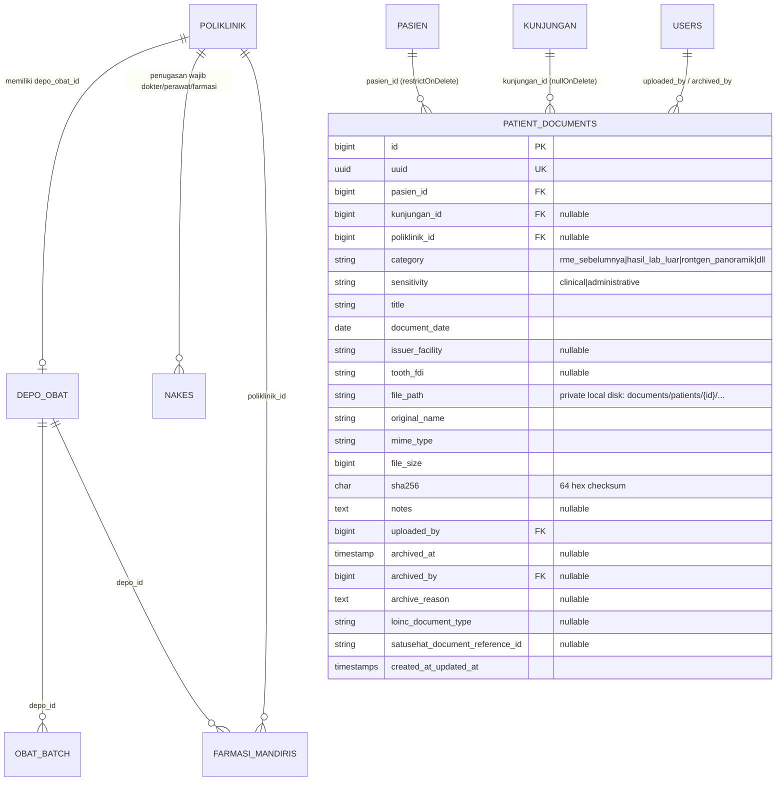

# 04 — Rencana Arsitektur Teknis, Skema Database, Keamanan Backend & Komponen Reusable
**Peran:** Lead Full-Stack & Database Architect  
**Mode Audit:** 100% Read-Only Codebase Inspection  
**Stack Aktual:** Laravel `^13.17` (PHP `^8.3`), Inertia.js `v3`, React `19.3`, TypeScript `5.9`, Tailwind CSS `v4`, SQLite & PostgreSQL 17 (`CaseInsensitivePostgresGrammar`).

---

## 1. Rancangan Perubahan Skema Database & Migrasi

> [!IMPORTANT]
> **Penjaga Integritas Database Eksisting yang WAJIB Dipatuhi:**
> 1. **Jebakan Rebuild Tabel SQLite (`CheckClinicalSecurity.php`):** Menambahkan *constrained foreign key* (`->constrained(...)`) pada tabel yang dilindungi trigger di SQLite akan memicu pembuatan ulang tabel dan **menghapus trigger SQLite secara diam-diam** (lihat pola pemulihan pada `2026_11_19_111000_restore_sqlite_clinical_guards_after_schema_upgrade.php` dan `2026_11_26_001500...:253`). Setiap migrasi yang memodifikasi `pasien`, `kunjungan`, `pemeriksaan`, `tindakan_kunjungan`, `farmasi`, atau `farmasi_mandiris` **WAJIB** memanggil kembali `CREATE TRIGGER IF NOT EXISTS protect_{table}_delete ...` khusus driver `sqlite` di akhir `up()`.
> 2. **Invarian Saldo Persediaan (`app/PersediaanRecorder.php:134–139`):** `assertBalance()` memverifikasi `SUM(obat_batch.stok) === obat.stok`. Isolasi stok per depo poli (`obat_batch.depo_id`) tetap mempertahankan `obat.stok` sebagai agregat total klinik dan menggunakan `SUM(obat_batch.stok WHERE depo_id = X)` untuk stok layak pakai per poli.
> 3. **Invarian Akun Tunggal (`2026_11_24_211900`):** Indeks unik `users_active_single_role_unique` membatasi maksimal **1 akun aktif** untuk `admin` dan `pendaftaran`, sementara `dokter`, `perawat`, dan `farmasi` mendukung multi-akun aktif per poli.

### 1.1 Desain ERD Perubahan Skema Terpadu (Wave 5 Final Pre-Release)

### 1.2 Rincian 3 File Migrasi Baru yang Bersih & Aditif

#### Migrasi A: `2026_11_27_090000_add_pharmacy_poli_scoping_and_depo_isolation.php`
1. **Tabel `depo_obat` & `poliklinik` (Data Reconciliation Aman):**
   - Pastikan tersedia 2 depo aktif terpisah bila poliklinik `umum` dan `gigi` masih berbagi 1 `depo_obat_id` yang sama (`DEPO-PU` untuk Poli Umum, `DEPO-PG` untuk Poli Gigi), lalu tautkan `poliklinik.depo_obat_id` masing-masing.
2. **Tabel `farmasi_mandiris`:**
   - Tambahkan `foreignId('poliklinik_id')->nullable()->after('petugas_id')->constrained('poliklinik')->nullOnDelete()`
   - Tambahkan `foreignId('depo_id')->nullable()->after('poliklinik_id')->constrained('depo_obat')->nullOnDelete()`
   - Tambahkan index komposit `['poliklinik_id', 'diserahkan_pada']` (`farmasi_mandiris_poli_date_idx`).
   - **Wajib di akhir `up()`:** Pulihkan trigger SQLite `protect_farmasi_mandiris_delete`!
3. **Tabel `stok_obat` (Opsional Ambang Minimum Per Poli):**
   - Tambahkan `unsignedInteger('stok_minimum_poli')->default(0)->after('stok')` agar peringatan stok menipis dapat dihitung spesifik per depo poli.

#### Migrasi B: `2026_11_27_091000_create_patient_documents_table.php`
- Membuat tabel `patient_documents` dengan kolom:
  - `id()` (PK) & `uuid('uuid')->unique()` (untuk parameter URL publik internal tanpa mengekspos urutan ID).
  - `foreignId('pasien_id')->constrained('pasien')->restrictOnDelete()` *(padanan konseptual `patient_id` sesuai penamaan tabel `pasien` pada codebase)*.
  - `foreignId('kunjungan_id')->nullable()->constrained('kunjungan')->nullOnDelete()` *(padanan konseptual `visit_id`)*.
  - `foreignId('poliklinik_id')->nullable()->constrained('poliklinik')->nullOnDelete()`.
  - `string('category', 40)` (`rme_sebelumnya`, `resume_medis_lama`, `hasil_lab_luar`, `radiologi_umum`, `rontgen_panoramik`, `rontgen_periapikal`, `rujukan_eksternal`, `dokumen_administratif`, `lainnya`).
  - `string('sensitivity', 20)->default('clinical')` (`clinical` | `administrative`).
  - `string('title', 200)`, `date('document_date')`, `string('issuer_facility', 150)->nullable()`, `string('tooth_fdi', 10)->nullable()`.
  - `string('file_path', 500)`, `string('original_name', 255)`, `string('mime_type', 100)`, `unsignedBigInteger('file_size')`, `char('sha256', 64)`.
  - `text('notes')->nullable()`.
  - `foreignId('uploaded_by')->constrained('users')->restrictOnDelete()`.
  - `timestamp('archived_at')->nullable()`, `foreignId('archived_by')->nullable()->constrained('users')->nullOnDelete()`, `text('archive_reason')->nullable()`.
  - `string('loinc_document_type', 32)->nullable()`, `string('satusehat_document_reference_id', 64)->nullable()`.
  - `timestamps()`.
  - Index: `['pasien_id', 'archived_at', 'document_date']`, `['kunjungan_id', 'archived_at']`, `['category', 'sensitivity']`.
- **Database Retention Trigger (`protect_patient_documents_delete`):**
  - Pasang trigger `BEFORE DELETE ON patient_documents` pada `sqlite`, `pgsql` (`reject_clinical_mutation()`), dan `mysql`/`mariadb` sehingga penghapusan fisik baris database ditolak di level engine RDBMS, serta daftarkan `patient_documents` ke `app/Console/Commands/CheckClinicalSecurity.php`.

#### Migrasi C: `2026_11_27_092000_complete_clinical_collaboration_and_satusehat_columns.php`
1. **Tabel `pasien` (Tanpa Kolom Fiktif — Gunakan Kolom Nyata Eksisting):**
   - **Tidak perlu menambah kolom `email` atau `photo_path` fiktif** pada `pasien` karena konteks Klinik Pratama Kementerian Pariwisata tidak menggunakan email/foto pasien, dan kolom kontak darurat/wali (`nama_wali`, `telepon_wali`) serta `kode_pos` **sudah tersedia nyata** di `app/Models/Pasien.php:20–22` (cukup dihubungkan pada `PatientRegistrationService`, `PasienController::show/edit`, dan `ManualPatientFields.tsx`).
2. **Tabel `pemeriksaan`:**
   - Tambahkan kolom pengukuran ulang TTV dokter: `unsignedSmallInteger('td_sistole_ulang')->nullable()`, `unsignedSmallInteger('td_diastole_ulang')->nullable()`, `unsignedSmallInteger('nadi_ulang')->nullable()`, `decimal('suhu_ulang', 4, 1)->nullable()`.
3. **Tabel `tindakan` & `tindakan_kunjungan`:**
   - Pada `tindakan`: `boolean('can_delegate_to_nurse')->default(true)->after('kategori')`.
   - Pada `tindakan_kunjungan`: `foreignId('performed_by_nakes_id')->nullable()->after('performed_by')->constrained('nakes')->nullOnDelete()`, lalu pulihkan trigger SQLite `protect_tindakan_kunjungan_delete` & `protect_tindakan_kunjungan_voided_update`!
4. **Tabel Pendukung Kesiapan SATUSEHAT & Rujukan Internal:**
   - Pada `screening`: `json('satusehat_observation_ids')->nullable()`.
   - Pada `odontogram_findings`: `string('snomed_finding_code', 32)->nullable()`, `string('snomed_bodysite_code', 32)->nullable()`, `string('satusehat_observation_id', 64)->nullable()`.
   - Pada `rujukan_internal`: `text('jawaban_konsultasi')->nullable()`, `timestamp('dijawab_pada')->nullable()`, `string('satusehat_service_request_id', 64)->nullable()`.
   - Pada `surat_medis`: `string('satusehat_service_request_id', 64)->nullable()`.

---

## 2. Penegakan Keamanan & RBAC di Level Backend

Seluruh aturan akses ditegakkan berlapis di **4 titik backend** (tidak pernah mengandalkan penyembunyian tombol di React):

### 2.1 Sinkronisasi 3 Lapisan Gatekeeper Rute
Setiap rute baru atau yang diperbaiki wajib didaftarkan secara konsisten pada ketiga lapisan yang diuji oleh `RouteAccessInventoryTest` dan `RoleBoundaryTest`:
1. **Route Middleware (`routes/web.php`):** Deklarasi eksplisit `EnsureRole::class.':...'`.
2. **Role Route Whitelist (`app/Http/Middleware/RedirectRegistrationRole.php`):**
   - Daftarkan rute dokumen pasien (`pelayanan.pasien.documents.*`) pada `isAllowedForNurse()` dan `isAllowedForDoctor()`, serta gunakan `->withoutMiddleware(RedirectRegistrationRole::class)` untuk rute yang diakses resmi oleh `pendaftaran`.
   - Rapikan daftar *whitelist* `isAllowedForRegistration()` sehingga konsisten dengan rute `general-consent.*`, `information-release.*`, dan `kepesertaan.*`.
3. **Global Clinical Gate (`app/Http/Middleware/ProtectClinicalInformation.php` + Policies):**
   - Tambahkan `PatientDocumentPolicy` yang memvalidasi:
     - Cakupan pasien (`PerawatClinicResolver` untuk perawat, `DoctorAccessService` + rujukan lintas poli untuk dokter).
     - Kelas sensitivitas (`admin` dan `pendaftaran` **ditolak `403`** saat mencoba `preview`/`download` dokumen dengan `sensitivity === 'clinical'`).
   - Perbarui `KunjunganPolicy` & `AdminPharmacyAssistance` untuk memanggil `App\FarmasiClinicResolver::authorizeVisit($user, $visit)` pada setiap aksi farmasi (mengembalikan `404` bila `visit.poliklinik_id !== $pharmacistClinicId`).

### 2.2 Form Requests & Eloquent Query Scopes
- **`App\FarmasiClinicResolver`:**
  - `nakes(User $user): Nakes`, `clinicId(User $user): int`, `clinicType(User $user): string`, `depoId(User $user): ?int`.
  - Dipasang pada `PharmacyStaffAccess::current()`, `FarmasiDashboardController`, `FarmasiController`, `PharmacyClinicalReviewController`, `FarmasiMandiriController`, `PersediaanController`, dan `HandleInertiaRequests::pharmacyQueues()`.
- **Eloquent Scopes:**
  - `Kunjungan::scopeForPharmacist(Builder $query, User $user)` $\rightarrow$ memfilter `poliklinik_id = FarmasiClinicResolver::clinicId($user)`.
  - `FarmasiMandiri::scopeForPharmacist(Builder $query, User $user)` $\rightarrow$ memfilter `poliklinik_id = FarmasiClinicResolver::clinicId($user)`.
  - `ObatBatch::scopeForDepo(Builder $query, ?int $depoId)` $\rightarrow$ mengisolasi ketersediaan batch dan mutasi stok pada depo poliklinik terkait (dengan fallback aman `depo_id IS NULL` khusus pengujian unit tanpa poliklinik di `SimplifiedClinicModulesTest`).
- **Dedicated Form Requests:**
  - `StorePatientDocumentRequest`: Validasi kategori, sensitivitas sesuai role, `document_date <= today`, serta validasi file ketat (`['required', 'file', 'mimes:pdf,jpg,jpeg,png', 'extensions:pdf,jpg,jpeg,png', 'max:10240']` + pemeriksaan `finfo_file` server-side terhadap polyglot/disguised scripts).
  - `ArchivePatientDocumentRequest`: Validasi `reason` (`['required', 'string', 'min:10', 'max:1000']`) + `ClinicalSigningCredential` bila dokumen telah terikat pada RME bertanda tangan.

### 2.3 Arsitektur Penyimpanan Privat, Integritas SHA-256 & Encrypted Backup
1. **Private Disk (`Storage::disk('local')`):**
   - Berdasarkan `config/filesystems.php`, disk `'local'` memetakan root ke `storage/app/private` (tidak dapat diakses melalui URL publik `/storage`).
   - Seluruh berkas `patient_documents` disimpan pada path **`documents/patients/{pasien_id}/{uuid}.{ext}`**.
2. **Integrasi Otomatis dengan `ClinicalBackup` (`app/ClinicalBackup.php`):**
   - Folder `'documents'` di `Storage::disk('local')` **sudah termasuk** dalam daftar enkripsi ZIP AES-256 `ClinicalBackup::create()` (`line 69`).
   - Tambahkan `['patient_documents', 'file_path']` ke konstanta `ClinicalBackup::REFERENCED_FILE_COLUMNS` (`app/ClinicalBackup.php:15–22`) agar perintah backup memverifikasi eksistensi dan keutuhan setiap berkas dokumen pasien!
   - Tambahkan pengecekan `PatientDocument::where('pasien_id', $patient->id)->exists()` ke `PasienController::hasPatientHistory()` (`line 781`) agar pasien yang telah memiliki dokumen tidak pernah bisa diarsipkan sebagai duplikat kosong.
3. **Authorized Controller Streaming (`PatientDocumentController`):**
   - `GET /pelayanan/pasien/{pasien}/dokumen/{document:uuid}/pratinjau` (`preview`): Memverifikasi `PatientDocumentPolicy::view`, memeriksa keutuhan `hash_equals($doc->sha256, hash_file('sha256', $fullPath))` (`409` bila korup), mencatat `patient_document.previewed` di `ClinicalAuditRecorder`, lalu mengalirkan response dengan header `Content-Disposition: inline`, `Content-Type` tervalidasi, `X-Content-Type-Options: nosniff`, `X-Frame-Options: SAMEORIGIN` (khusus iframe preview PDF internal), dan `Cache-Control: private, no-store`.
   - `GET /pelayanan/pasien/{pasien}/dokumen/{document:uuid}/unduh` (`download`): Sama dengan di atas menggunakan `Content-Disposition: attachment` dan audit event `patient_document.downloaded`.

---

## 3. Arsitektur Komponen Reusable (Frontend Refactoring Plan)

> [!WARNING]
> **Invariansi Pengujian Frontend (`tests/frontend-render.test.mjs`) yang WAJIB Dijaga:**
> 1. **Larangan Kelas Tipografi & Cetak:** Jangan pernah menggunakan `font-mono`, `font-serif`, `font-black`, atau `window.print()` di `.ts`/`.tsx`! Selalu gunakan `font-sans tabular-nums` dan `printWithFonts()` (`@/lib/print-typography`).
> 2. **Hierarki Heading & ARIA:** `AppLayout` merender `<h1 className="sr-only">`. Seluruh judul halaman harus memakai `<h2>`. Pertahankan `aria-label="Filter data"`, `Reset filter`, dan `aria-label="Filter aktif"` pada komponen filter, serta `<nav aria-label="Menu profil pasien">` pada profil pasien.
> 3. **Keunikan Atribut `id`:** Selalu gunakan React `useId()` pada komponen *reusable* agar tidak terjadi duplikasi `id` DOM saat dirender lebih dari sekali dalam satu halaman.

### Peta 8 Komponen Standar yang Dibangun / Disempurnakan

| Komponen | Lokasi File Target | Kontrak Props & Tanggung Jawab Standarisasi |
| :--- | :--- | :--- |
| **`PageHeaderWithActions`** | `resources/js/components/ui/page-header.tsx` | `{ eyebrow?: string; title: string; description?: ReactNode; badge?: ReactNode; backUrl?: string; backLabel?: string; actions?: ReactNode }` — Menyeragamkan judul `<h2>` di kiri dan tombol `Kembali` (`<ArrowLeft />` `secondary`) + tombol aksi di kanan. Menghapus seluruh tombol melayang di atas judul! |
| **`FormActionFooter`** | `resources/js/components/ui/form-action-footer.tsx` | `{ cancelUrl?: string; onCancel?: () => void; cancelLabel?: string; submitLabel: string; processing?: boolean; disabled?: boolean; leadingNote?: ReactNode; children?: ReactNode }` — Menjamin 100% tombol eksekusi form berada di kanan (`justify-end`) dengan pemisah `border-t border-neutral-100 pt-4`. |
| **`TableFilterBar`** | `resources/js/components/ui/table-filter-bar.tsx` | Membungkus & memperluas `FilterPanel` (`ui/filter-panel.tsx`) dengan dukungan mode `card` (standalone di atas tabel) dan mode `inline` (kompak di kanan atas header kartu seperti pada Profil Pasien), tetap mempertahankan `aria-label="Filter data"` dan tombol `Reset filter`. |
| **`DataTableWrapper`** | `resources/js/components/ui/data-table-wrapper.tsx` | `{ title: string; description?: ReactNode; icon?: ReactNode; headerActions?: ReactNode; filterBar?: ReactNode; pagination?: PaginationData | null; isEmpty?: boolean; emptyTitle?: string; emptyDescription?: string; minWidthClassName?: string; children: ReactNode }` — Menyatukan `Card` + Header + `inline/attached Filter` + `Table` bebas *hover-clash* + `Empty` (`hover:bg-transparent`) + `Pagination`. |
| **`Alert` & `Toaster` (Unified)** | `resources/js/components/ui/alert.tsx` & `sonner.tsx` | Menambahkan varian warna semantik `success` (emerald), `info` (blue), `warning` (amber), `destructive` (red) lengkap light/dark mode; tombol **Close (X)** aktif default pada semua varian; *auto-dismiss* (`4500ms` sukses/info, `7000ms` warning, `8000ms` error kecuali `persistent={true}`); dukungan flash `warning` & `info`. |
| **`SummaryStatGrid`** | `resources/js/components/dashboard/summary-stat-grid.tsx` | `{ columns?: 2 | 3 | 4 | 5; children: ReactNode }` + pembaruan `StatCard` & `FollowUp` — Mengatur tata letak grid KPI responsif yang proporsional (mencegah 1 kartu yatim melebar penuh pada kelompok 5 kartu) dan memperbaiki efek hover `FollowUp`. |
| **`PatientProfileLayout`** | `resources/js/components/pasien/patient-profile-layout.tsx` | Mengimplementasikan tata letak referensi 2 kolom (`~31%` panel kiri identitas/badge/navigasi berikon+chevron/info umum/info kontak; `~69%` area kerja kanan bertab + grid bawah 2 kolom Dokumen & Catatan Klinis) dengan menjaga kompatibilitas penuh terhadap `aria-label="Menu profil pasien"`. |
| **`DocumentUploaderModal` & `DocumentPreviewDialog`** | `resources/js/components/pasien/document-uploader-modal.tsx` | Modal unggah dokumen (`title`, `category`, `document_date`, `issuer_facility`, `tooth_fdi`, `kunjungan_id`, `notes`, validasi ukuran $\le 10$ MB & progres unggah) + modal pratinjau cepat gambar/PDF privat (`inline`) dan aksi arsip beralasan (`confirmReason` $\ge 10$ karakter). |

---

## 4. Urutan Eksekusi Teknis Aman (Zero-Regression Dependency Order)

Untuk mencegah konflik migrasi, kegagalan TypeScript, atau rusaknya 624 pengujian PHPUnit & 312 pengujian SSR yang sudah ada, eksekusi wajib mengikuti 5 tahap berurutan berikut:

1. **Tahap 1 — Fondasi Skema Database, Trigger & Layanan Keamanan Backend:**
   - Eksekusi ke-3 migrasi baru + pembaruan `CheckClinicalSecurity` + verifikasi `php artisan clinic:security-check` & `php artisan clinic:audit-database` pada SQLite & PostgreSQL.
   - Implementasi `App\FarmasiClinicResolver`, `PatientDocument` model, `PatientDocumentPolicy`, pembaruan `ClinicalBackup`, `PersediaanRecorder`, dan seeder 2 akun/depo farmasi (`KemenparPreReleaseSeeder`).
2. **Tahap 2 — Penegakan RBAC, Isolasi Farmasi Per Poli & Perbaikan Logika Klinis Backend:**
   - Isolasi seluruh controller Farmasi & Persediaan ke poli/depo penugasan + rute ekspor persediaan.
   - Perbaikan P0 klinis: gerbang `GeneralConsent` (`refused` tidak boleh lolos), verifikasi lintas kunjungan, penguncian cetak Surat Medis & Resep Luar sebelum `signed_at` + PIN, pembaruan tabel `diagnosa` pada koreksi coding, kesinambungan baca RME lintas poli, kewajiban `aturan_pakai`, sinkronisasi alergi, serta endpoint `PatientDocumentController`.
   - Perbaikan kebocoran lintas poli `laporanTopDiagnosa` untuk perawat & validasi kesesuaian poli jadwal dokter.
3. **Tahap 3 — Pembangunan Design System & 8 Komponen Reusable Global:**
   - Perbaikan token dark mode di `resources/css/app.css` & `ui/table.tsx` + pratinjau etiket `farmasi/show.tsx`.
   - Pembaruan komponen inti `Alert`, `Toaster`, `Button`, `FollowUp`, serta pembuatan `PageHeaderWithActions`, `FormActionFooter`, `TableFilterBar`, `DataTableWrapper`, `SummaryStatGrid`, `PatientProfileLayout`, dan `DocumentUploaderModal`.
   - Pembaruan `HandleInertiaRequests.php`, `app-layout.tsx` (judul halaman hilang, breadcrumb bersih dari ID mentah, penghapusan menu duplikat/tidak relevan), dan helper navigasi `ContextualBackUrl`.
4. **Tahap 4 — Redesain Screen Profil, Standarisasi Tabel/Filter/Tombol/KPI & Narasi Klinis:**
   - Implementasi penuh **Screen Profil Pasien 2-Kolom** + perapihan Profil Akun, Pengaturan Klinik, Kualifikasi Farmasi, Detail Poliklinik, dan Kepesertaan.
   - Pemasangan bar filter lengkap pada **Reservasi 7 Hari ke Depan**, **Kalender Libur Praktik**, Stok Dokter, Kartu Stok, dan seluruh tabel kategori (A).
   - Penataan ulang seluruh tombol (`Simpan Register` di kanan pada `pelepasan.tsx`, `Register Pelepasan Informasi` di header kanan pada `general-consent.tsx`, tombol `Back` seragam di seluruh aplikasi).
   - Penambahan Card Total reaktif filter pada **Laporan Pengkajian Awal** dan penyelarasan seluruh halaman laporan/dasbor + penerapan 37 standar narasi klinis baku.
5. **Tahap 5 — Pengujian Otomatis, Regresi Penuh & Audit Pra-Rilis:**
   - Pembaruan & penambahan Feature Test PHPUnit (termasuk pengujian isolasi Farmasi Poli Umum vs Poli Gigi, `PatientDocumentTest`, `GeneralConsentFlowTest`, `PatientProfileTest`) + Node SSR test (`npm run test:frontend`), `npm run types:check`, `npm run build`, Laravel Pint, `clinic:security-check`, dan `clinic:audit-database`.
